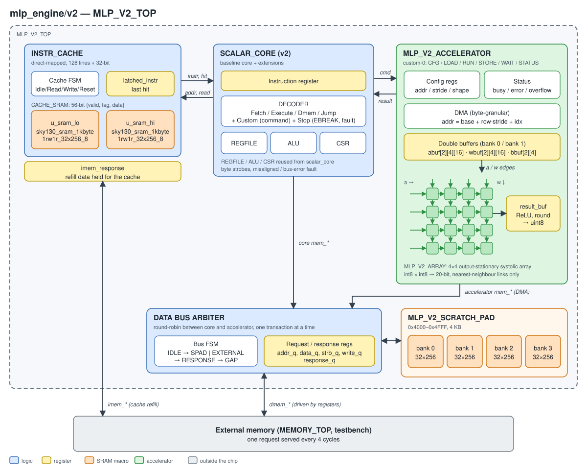

# MLP-EngineV2

This repository contains three RISC-V designs that run the same 3-layer MLP
MNIST classifier, along with their programs, Verilator testbenches, and an
open-source sky130 implementation flow. **`mlp_engine/v2` is the main design.**

| Design | Top module | Description | Details |
|---|---|---|---|
| `scalar_core` | `CPU_TOP` | Multi-cycle RV32IM core + instruction cache. Software-only inference. | [rtl/scalar_core](rtl/scalar_core/README.md) |
| `mlp_engine/v1` | `CPU_TOP` | Baseline core + 4×4 broadcast MAC array + 4 KB scratchpad. Controlled by repurposed standard instructions. | [rtl/mlp_engine/v1](rtl/mlp_engine/v1/README.md) |
| `mlp_engine/v2` | `MLP_V2_TOP` | Extended baseline core + independent accelerator + 4 KB scratchpad + data-bus arbiter. Controlled by custom-0 instructions. | [rtl/mlp_engine/v2](rtl/mlp_engine/v2/README.md) |

All three designs use LibreLane 3.0.2 on sky130A with one shared set of PnR
settings ([librelane/README.md](librelane/README.md)), and all three pass PnR
on a 2200×2200 µm die.

- [mlp_engine/v2 overview](#mlp_enginev2-overview)
- [Motivation for v1 → v2](#motivation-for-v1--v2)
- [Environment setup](#environment-setup)
- [How to run](#how-to-run)
- [Results](#results)

## mlp_engine/v2 overview

<p align="center"></p>

- **Core:** the baseline multi-cycle RV32IM core, extended with an instruction
  register and a command state that sends custom-0 instructions to the
  accelerator.
- **Accelerator:** a DMA moves operands between memory and double-buffered
  operand buffers. A 4×4 output-stationary systolic array computes int8 × int8
  → 20-bit, and the results go back through ReLU and uint8 requantization.
- **Commands:** `CFG` (addresses, strides, shape), `LOAD`, `RUN`, `STORE`,
  `WAIT`, `STATUS`. Each layer runs as
  `CFG` → `LOAD` → (`RUN` while the next `LOAD` fills the other bank) → `STORE`.
- **Memory:** a round-robin, registered data-bus arbiter shares the external
  data port and the 4 KB scratchpad (0x4000–0x4FFF) between the core and the
  DMA. Layer outputs stay in the scratchpad and feed the next layer.

See [rtl/mlp_engine/v2/README.md](rtl/mlp_engine/v2/README.md) for the
blocks, double buffering, `pack()`, and data widths.

## Motivation for v1 → v2

### 1. Data movement was tied to CPU instructions

- **v1 limitation**
  - The array is a functional unit inside the core. 
    Every element moved into or out of the array costs one CPU instruction (`LH`/`LHU`/`SH`/`LBU`, …), and the array's input is the core's load write-back data.
  - Each instruction walks the multi-cycle FSM (Fetch → Execute → Dmem), so CPI is ≈4.
- **v2 solution**
  - The accelerator is a separate bus master with its own DMA.
  - The CPU issues a few commands per tile (`CFG`, `LOAD`, `RUN`, `STORE`).
    Per-element address generation and memory access are done by the DMA.
  - Double buffering (`abuf`/`wbuf [2]`) overlaps the next tile's transfer with the current tile's computation.
- **Result:** latency per image went from 38.0% to 7.7% of scalar_core, and throughput per area from 0.69 to 2.69 img/s/mm² (3.9×).

### 2. Standard instructions were repurposed as accelerator commands

- **v1 limitation**
  - v1 changes the meaning of the standard RISC-V instructions `LB`, `LBU`, `LH`, `LHU`, `SB`, `SH`, `MULH`, `MULHU`.
- **v2 solution**
  - Commands live in the custom-0 opcode space (`0x0B`), which the RISC-V spec reserves for extensions.
  - The v2 program uses ordinary byte operations in `pack()`.

### 3. Array scalability

- **v1 limitation**
  - The v1 array broadcasts: weight register `registers[j]` drives every PE in column j, and input register `registers[Cols+i]` drives every PE in row i.
  - All PEs perform a MAC in the same cycle.
  - Growing to N×N raises the fanout and wire length per register linearly with N, and lengthens the critical path.
- **v2 solution**
  - An output-stationary systolic array: operands move one PE per cycle through registers.
  - Wire length and the per-PE critical path stay constant as N grows.
- **Cost:** compared with v1, v2 uses 1.28× the area and 1.84× the power.

## Environment setup

### Tools

| Item | Version / source |
|---|---|
| PnR flow | LibreLane 3.0.2 (`ghcr.io/librelane/librelane:3.0.2`): OpenROAD 2026-02, Yosys 0.62 + slang, Magic, KLayout, Netgen |
| PDK | sky130A, ciel version `8afc8346a57fe1ab7934ba5a6056ea8b43078e71` |
| Std cells / SRAM | `sky130_fd_sc_hd`; OpenRAM `sky130_sram_1kbyte_1rw1r_32x256_8`, `sky130_sram_1kbyte_1rw1r_8x1024_8` |
| Simulation | Verilator v5.024, SystemC 2.3.4, UVM-SystemC 1.0-beta5 |
| RISC-V toolchain | xPack riscv-none-elf-gcc 14.2.0-3 (symlinked as `riscv32-unknown-elf-*`) |

### PDK (on the host)

Both containers mount the host's `~/.ciel` read-only at `/pdk`, so install the
PDK once on the host:

```bash
pip install ciel
ciel enable --pdk-family sky130 8afc8346a57fe1ab7934ba5a6056ea8b43078e71
# → ~/.ciel/ciel/sky130/versions/8afc8346.../sky130A
```

The gate-level Makefiles (`sim/pnl_sim/tb/*/Makefile`) reference this hash via `SRAM_MACRO_COMMIT`. 
Update it if you use a different PDK version.

### Containers

| Service | Image | Purpose |
|---|---|---|
| `sim` | `mlp-engine/sim:latest` (built from `docker/Dockerfile`) | RISC-V program build, Verilator RTL / gate-level simulation |
| `librelane` | `ghcr.io/librelane/librelane:3.0.2` (pulled as is) | Synthesis, PnR, signoff |

Both mount the repository root at `/workspace` and set `PDK_ROOT=/pdk`.

```bash
cd docker
HOST_UID=$(id -u) HOST_GID=$(id -g) docker compose build sim   # build the sim image
docker compose up -d sim librelane                             # start both containers
docker start sim librelane                                     # restart existing containers
docker exec -it sim bash                                       # shell into a container
docker exec -it librelane bash
```

### Test data

Images, labels, and parameters are stored only as zips. The extracted
directories are git-ignored.

```bash
cd program/test_code
unzip -o image.zip && unzip -o label.zip && unzip -o parameter.zip
```

## How to run

### Program and simulation (`sim` container)

```bash
# RISC-V program only → program/test_code/src/<design>/build/image_<N>_<tag>/
make -C program/test_code/src/<design> TB_NUM=10

# RTL simulation (rebuilds the program with the same run tag); N = 10 / 100 / 1000 / 10000
make -C sim/rtl_sim/tb/<design> run TB_NUM=10

# Gate-level simulation of the latest PnR netlist (or NETLIST=...)
make -C sim/pnl_sim/tb/<design> run
```

### Synthesis + PnR (`librelane` container)

```bash
cd /workspace/librelane/<design>
./run.sh                       # → librelane/<design>/runs/RUN_<date>_<time>/

# or from the host, in the background
docker exec -d librelane bash -c "cd /workspace/librelane/<design>; bash run.sh > runs/run.log 2>&1"
```

PnR settings and their rationale: [librelane/README.md](librelane/README.md).

## Results

sky130A, LibreLane 3.0.2, 2200×2200 µm die, same PnR settings for all designs.
The clock period is 180 ns and the I/O delay is 20% of the period (36 ns).
Delay and power come from post-PnR STA at `nom_tt_025C_1v80`. 
Mcycle and accuracy come from Verilator RTL simulation, cross-checked at #10 with gate-level simulation of the PnR netlist. 

### PnR metrics

| Metric | scalar_core | mlp_engine/v1 | mlp_engine/v2 |
|---|---:|---:|---:|
| **Time delay (ns)** | 24.70 (100%) | 23.02 (93.2%) | 5.78 (23.4%) |
| **Total power (mW)** | 1.151 (100%) | 2.304 (200.2%) | 4.242 (368.5%) |
| └ Sequential / Combinational | 0.312 / 0.040 | 0.401 / 0.045 | 1.190 / 0.235 |
| └ Clock | 0.354 | 0.539 | 1.481 |
| └ SRAM macros | 0.445 | 1.318 | 1.336 |
| **Cell area (µm², std cells + SRAM)** | 829,529 (100%) | 1,835,919 (221.3%) | 2,347,270 (283.0%) |
| └ Std cells total | 448,104 | 641,399 | 1,202,990 |
| └ Logic (sequential + combinational) | 267,385 | 441,772 | 831,229 |
| └ Timing-repair buffers | 102,145 (10,197) | 136,990 (14,154) | 292,951 (29,667) |
| └ Clock tree | 4,730 | 7,918 | 21,830 |
| └ Antenna diodes | 480 (192) | 688 (275) | 1,359 (543) |
| └ Tap cells | 73,363 | 54,032 | 55,625 |
| └ SRAM macros | 381,425 (2) | 1,194,520 (6) | 1,144,280 (6) |
| Std-cell NAND2 equivalent (÷ 3.75 µm²) | 119.5k | 171.0k | 320.8k |
| Post-synthesis std-cell area (µm²) | 264,937 (100%) | 439,109 (165.7%) | 827,704 (312.4%) |
| Setup WNS: nom_tt / worst of 9 corners (ns) | 29.05 / 7.06 | 30.73 / 10.04 | 47.97 / 43.28 |
| Hold WNS, 9 corners (ns) | 0.070 | 0.068 | 0.047 |
| Setup / hold violations | 0 / 0 | 0 / 0 | 0 / 0 |
| Max slew / cap / fanout violations | 0 / 0 / 0 | 0 / 0 / 0 | 0 / 0 / 0 |
| Route / Magic / KLayout DRC | 0 / 0 / 0 | 0 / 0 / 0 | 0 / 0 / 0 |
| LVS / XOR / Antenna | 0 / 0 / 0 | 0 / 0 / 0 | 0 / 0 / 0 |
| Utilization (std cells + SRAM / core) | 17.8% | 39.5% | 50.5% |
| Wirelength | 1.68 m | 2.54 m | 5.14 m |

- **Hold slack** of 0.05–0.07 ns already includes 0.25 ns clock uncertainty and ±5% derating.

### Throughput (#10000)

| Metric | scalar_core | mlp_engine/v1 | mlp_engine/v2 |
|---|---:|---:|---:|
| Cycles per image | 11,489,724 (100%) | 4,367,390 (38.0%) | 881,179 (7.7%) |
| **Latency per image (ms)** | 2,068 (100%) | 786 (38.0%) | 159 (7.7%) |
| **Throughput (img/s)** | 0.48 (100%) | 1.27 (263%) | 6.30 (1,304%) |
| **Throughput per area (img/s/mm²)** | 0.58 (100%) | 0.69 (119%) | 2.69 (461%) |

- Latency = mcycle(#10000) / 10000 × 180 ns. Throughput is its inverse.
- Throughput per area uses the cell area (std cells + SRAM).

### Mcycle (hex)

| Design | #10 | #100 | #1000 | #10000 |
|---|---:|---:|---:|---:|
| scalar_core | 06D932D0 (100%) | 447BEBCE (100%) | 2ACD74DD5 (100%) | 1AC068C6A4 (100%) |
| mlp_engine/v1 | 031FE6C6 (45.6%) | 1A086B44 (38.0%) | 104522376 (38.0%) | A2B2AD817 (38.0%) |
| mlp_engine/v2 | 0184B00A (22.2%) | 06271870 (9.0%) | 35573E4A (7.8%) | 20D39429D (7.7%) |

### Accuracy (%)

| Design | #10 | #100 | #1000 | #10000 |
|---|---:|---:|---:|---:|
| scalar_core | 100.00 | 100.00 | 96.80 | 96.76 |
| mlp_engine/v1 | 100.00 | 99.00 | 91.80 | 92.68 |
| mlp_engine/v2 | 100.00 | 100.00 | 96.60 | 96.72 |

### Gate-level simulation (#10, 2200-die netlists)

| Design | mcycle | minstret | Accuracy | 
|---|---:|---:|---:|
| scalar_core | 06D932D0 | 0190B423 | 100.00 | 
| mlp_engine/v1 | 031FE6C6 | 00BCF641 | 100.00 | 
| mlp_engine/v2 | 0184B00A | 00437553 | 100.00 |
