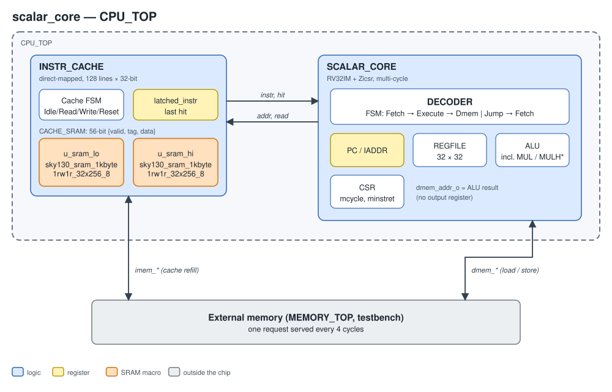

# MLP-EngineV2

This repository contains three RISC-V designs that run the same 3-layer MLP MNIST classifier, along with their programs, Verilator testbenches, and an open-source sky130 implementation flow:

| Design | Top module | Description |
|---|---|---|
| `scalar_core` | `CPU_TOP` | Multi-cycle RV32IM core + instruction cache. Software-only inference. |
| `mlp_engine/v1` | `CPU_TOP` | Baseline core + 4×4 broadcast MAC array + 4 KB scratchpad. Controlled by repurposed standard instructions. |
| `mlp_engine/v2` | `MLP_V2_TOP` | Extended baseline core + Independent accelerator + 4 KB scratchpad + Data-bus arbiter. Controlled by custom-0 instructions.|

All three designs use LibreLane 3.0.2 on sky130A with one shared set of PnR settings. All three pass PnR on a 2200×2200 µm die.

- [Repository layout](#repository-layout)
- [Design architectures](#design-architectures)
- [Results](#results)
- [Motivation for v1 → v2](#motivation-for-v1--v2)
- [Environment setup](#environment-setup)
- [How to run](#how-to-run)
- [PnR settings and rationale](#pnr-settings-and-rationale)
- [v1 RTL fix](#v1-rtl-fix)

## Design architectures

All three designs share the same instruction cache and the same external memory interface.

### scalar_core (baseline)

<p align="center"></p>

### mlp_engine/v1

<p align="center"></p>

v1 instruction mapping (standard opcodes repurposed):

| Instruction | v1 meaning |
|---|---|
| `LB` | scratchpad → array PE buffer (bias) |
| `LBU` | array PE buffer → scratchpad |
| `LH` | scratchpad → array data buffer |
| `LHU` | external memory → array data buffer |
| `SB` | array PE buffer → external memory |
| `SH` | external memory → scratchpad |
| `MULH` | MAC in every PE |
| `MULHU` | ReLU (negative → 0) in every PE |

Data widths in the array:

| Item | Width | Notes |
|---|---|---|
| Activation | 9-bit unsigned | Bits [8:1] of the loaded 32-bit value, with LSB forced to 1 (`{rf_write_data[8:1], 1'b1}`) |
| Weight | 9-bit signed | Same extraction |
| Bias | 9-bit | Loaded from the scratchpad with `LB` and zero-extended into the 18-bit partial sum |
| Product | 18-bit | 10-bit signed weight × 10-bit zero-extended activation = 20 bits, truncated to 18 bits |
| Partial sum | 18-bit | Accumulated by `MULH` (wraps on overflow, no detection); `MULHU` sets negative values to 0 |
| Output | 9-bit | MSB of the partial sum = 1 → `0x1FF` (saturate); otherwise `psum[16:8] + psum[7]` (round) |
| Scratchpad entry | 8-bit | Stores bits [8:1] of the written value; on read the LSB is forced back to 1 |

### mlp_engine/v2

<p align="center"></p>

Accelerator commands (custom-0, `funct3`): `CFG` (0), `LOAD` (1), `RUN` (2), `STORE` (3), `WAIT` (4), `STATUS` (5). 

How the v2 program uses it: `CFG` → `LOAD` → (`RUN` while the next `LOAD` fills the other bank) → `STORE`.

**Double buffering:** the operand buffers have two banks (`abuf[2][4][16]`, `wbuf[2][4][16]`, `bbuf[2][4]`). 
While the array computes a 16-element K tile from one bank, the DMA loads the next tile into the other bank, and the two banks swap roles every tile. 
This overlaps data transfer with computation.

```
bank 0:  LOAD tile0 | RUN tile0  | LOAD tile2 | RUN tile2  | ...
bank 1:             | LOAD tile1 | RUN tile1  | LOAD tile3 | ...
```

**`pack()`:** the testbench preloads every value (image pixel, weight, bias) as one 32-bit word. 
`pack()` runs on the scalar core. 
It takes the low 8 bits of four consecutive words and stores them as the four bytes of one word in RAM.
The DMA reads these packed bytes, and packing time is included in mcycle.

Data widths in the accelerator:

| Item | Width | Notes |
|---|---|---|
| Activation | 8-bit unsigned | Low 8 bits of each 32-bit value, packed 4 per word by the core (`pack()`) |
| Weight| 8-bit signed | Same packing |
| Bias | 8-bit signed | Sign-extended to 20 bits and loaded as the initial sum |
| Product | 17-bit signed | `{1'b0, a} × w` (the activation is zero-extended so values ≥ 128 stay positive) |
| Accumulator | 20-bit signed | Computed in 21 bits; a sign mismatch sets the overflow flag and reports `ERR_OVERFLOW` |
| Output  | 8-bit unsigned | ReLU, then round `(sum + 128) >>> 8` and saturate to 255 (≤ 0 → 0, ≥ 65408 → 255) |

Each layer's 8-bit output is written to the scratchpad and used directly as
the next layer's activation.


---

## Results

sky130A, LibreLane 3.0.2, 2200×2200 µm die, same PnR settings for all designs.
The clock period is 180 ns and the I/O delay is 20% of the period (36 ns).
Delay and power come from post-PnR STA at `nom_tt_025C_1v80`. 
Mcycle andaccuracy come from Verilator RTL simulation, cross-checked at #10 with gate-level simulation of the PnR netlist. 

### PnR metrics

| Metric | scalar_core | mlp_engine/v1 | mlp_engine/v2 |
|---|---:|---:|---:|
| **Time delay (ns)** | 24.70 (100%) | 23.02 (93.2%) | 5.78 (23.4%) |
| **Total power (mW)** | 1.151 (100%) | 2.304 (200.2%) | 4.242 (368.5%) |
| └ Sequential / Combinational | 0.312 / 0.040 | 0.401 / 0.045 | 1.190 / 0.235 |
| └ Clock | 0.354 | 0.539 | 1.481 |
| └ SRAM macros | 0.445 | 1.318 | 1.336 |
| **Cell area (µm², std cells + SRAM)** | 829,529 (100%) | 1,835,919 (221.3%) | 2,347,270 (283.0%) |
| └ Std cells total | 448,104 | 641,399 | 1,202,990 |
| └ Logic (sequential + combinational) | 267,385 | 441,772 | 831,229 |
| └ Timing-repair buffers | 102,145 (10,197) | 136,990 (14,154) | 292,951 (29,667) |
| └ Clock tree | 4,730 | 7,918 | 21,830 |
| └ Antenna diodes | 480 (192) | 688 (275) | 1,359 (543) |
| └ Tap cells | 73,363 | 54,032 | 55,625 |
| └ SRAM macros | 381,425 (2) | 1,194,520 (6) | 1,144,280 (6) |
| Std-cell NAND2 equivalent (÷ 3.75 µm²) | 119.5k | 171.0k | 320.8k |
| Post-synthesis std-cell area (µm²) | 264,937 (100%) | 439,109 (165.7%) | 827,704 (312.4%) |
| Setup WNS: nom_tt / worst of 9 corners (ns) | 29.05 / 7.06 | 30.73 / 10.04 | 47.97 / 43.28 |
| Hold WNS, 9 corners (ns) | 0.070 | 0.068 | 0.047 |
| Setup / hold violations | 0 / 0 | 0 / 0 | 0 / 0 |
| Max slew / cap / fanout violations | 0 / 0 / 0 | 0 / 0 / 0 | 0 / 0 / 0 |
| Route / Magic / KLayout DRC | 0 / 0 / 0 | 0 / 0 / 0 | 0 / 0 / 0 |
| LVS / XOR / Antenna | 0 / 0 / 0 | 0 / 0 / 0 | 0 / 0 / 0 |
| Utilization (std cells + SRAM / core) | 17.8% | 39.5% | 50.5% |
| Wirelength | 1.68 m | 2.54 m | 5.14 m |

- **Hold slack** of 0.05–0.07 ns already includes 0.25 ns clock uncertainty and ±5% derating.

### Throughput (#10000)

| Metric | scalar_core | mlp_engine/v1 | mlp_engine/v2 |
|---|---:|---:|---:|
| Cycles per image | 11,489,724 (100%) | 4,367,390 (38.0%) | 881,179 (7.7%) |
| **Latency per image (ms)** | 2,068 (100%) | 786 (38.0%) | 159 (7.7%) |
| **Throughput (img/s)** | 0.48 (100%) | 1.27 (263%) | 6.30 (1,304%) |
| **Throughput per area (img/s/mm²)** | 0.58 (100%) | 0.69 (119%) | 2.69 (461%) |

- Latency = mcycle(#10000) / 10000 × 180 ns. Throughput is its inverse.
- Throughput per area uses the cell area (std cells + SRAM).

### Mcycle (hex)

| Design | #10 | #100 | #1000 | #10000 |
|---|---:|---:|---:|---:|
| scalar_core | 06D932D0 (100%) | 447BEBCE (100%) | 2ACD74DD5 (100%) | 1AC068C6A4 (100%) |
| mlp_engine/v1 | 031FE6C6 (45.6%) | 1A086B44 (38.0%) | 104522376 (38.0%) | A2B2AD817 (38.0%) |
| mlp_engine/v2 | 0184B00A (22.2%) | 06271870 (9.0%) | 35573E4A (7.8%) | 20D39429D (7.7%) |

### Accuracy (%)

| Design | #10 | #100 | #1000 | #10000 |
|---|---:|---:|---:|---:|
| scalar_core | 100.00 | 100.00 | 96.80 | 96.76 |
| mlp_engine/v1 | 100.00 | 99.00 | 91.80 | 92.68 |
| mlp_engine/v2 | 100.00 | 100.00 | 96.60 | 96.72 |

### Gate-level simulation (#10, 2200-die netlists)

| Design | mcycle | minstret | Accuracy | 
|---|---:|---:|---:|
| scalar_core | 06D932D0 | 0190B423 | 100.00 | 
| mlp_engine/v1 | 031FE6C6 | 00BCF641 | 100.00 | 
| mlp_engine/v2 | 0184B00A | 00437553 | 100.00 | 

---

## Motivation for v1 → v2

### 1. Data movement was tied to CPU instructions

- **v1 limitation**
  - The array is a functional unit inside the core. 
    Every element moved into or out of the array costs one CPU instruction (`LH`/`LHU`/`SH`/`LBU`, …), and the array's input is the core's load write-back data.
  - Each instruction walks the multi-cycle FSM (Fetch → Execute → Dmem), so CPI is ≈4.
- **v2 solution**
  - The accelerator is a separate bus master with its own DMA.
  - The CPU issues a few commands per tile (`CFG`, `LOAD`, `RUN`, `STORE`).
    Per-element address generation and memory access are done by the DMA.
  - Double buffering (`abuf`/`wbuf [2]`) overlaps the next tile's transfer with the current tile's computation.
- **Result:** latency per image went from 38.0% to 7.7% of scalar_core, and throughput per area from 0.69 to 2.69 img/s/mm² (3.9×).

### 2. Standard instructions were repurposed as accelerator commands

- **v1 limitation**
  - v1 changes the meaning of the standard RISC-V instructions `LB`, `LBU`, `LH`, `LHU`, `SB`, `SH`, `MULH`, `MULHU`.
- **v2 solution**
  - Commands live in the custom-0 opcode space (`0x0B`), which the RISC-V spec reserves for extensions.
  - The v2 program uses ordinary byte operations in `pack()`.

### 3. Array scalability

- **v1 limitation**
  - The v1 array broadcasts: weight register `registers[j]` drives every PE in column j, and input register `registers[Cols+i]` drives every PE in row i.
  - All PEs perform a MAC in the same cycle.
  - Growing to N×N raises the fanout and wire length per register linearly with N, and lengthens the critical path.
- **v2 solution**
  - An output-stationary systolic array: operands move one PE per cycle through registers.
  - Wire length and the per-PE critical path stay constant as N grows.
- **Cost:** compared with v1, v2 uses 1.28× the area and 1.84× the power.

---

## Environment setup

### Tools

| Item | Version / source |
|---|---|
| PnR flow | LibreLane 3.0.2 (`ghcr.io/librelane/librelane:3.0.2`): OpenROAD 2026-02, Yosys 0.62 + slang, Magic, KLayout, Netgen |
| PDK | sky130A, ciel version `8afc8346a57fe1ab7934ba5a6056ea8b43078e71` |
| Std cells / SRAM | `sky130_fd_sc_hd`; OpenRAM `sky130_sram_1kbyte_1rw1r_32x256_8`, `sky130_sram_1kbyte_1rw1r_8x1024_8` |
| Simulation | Verilator v5.024, SystemC 2.3.4, UVM-SystemC 1.0-beta5 |
| RISC-V toolchain | xPack riscv-none-elf-gcc 14.2.0-3 (symlinked as `riscv32-unknown-elf-*`) |

### PDK (on the host)

Both containers mount the host's `~/.ciel` read-only at `/pdk`, so install the
PDK once on the host:

```bash
pip install ciel
ciel enable --pdk-family sky130 8afc8346a57fe1ab7934ba5a6056ea8b43078e71
# → ~/.ciel/ciel/sky130/versions/8afc8346.../sky130A
```

The gate-level Makefiles (`sim/pnl_sim/tb/*/Makefile`) reference this hash via `SRAM_MACRO_COMMIT`. 
Update it if you use a different PDK version.

### Containers

| Service | Image | Purpose |
|---|---|---|
| `sim` | `mlp-engine/sim:latest` (built from `docker/Dockerfile`) | RISC-V program build, Verilator RTL / gate-level simulation |
| `librelane` | `ghcr.io/librelane/librelane:3.0.2` (pulled as is) | Synthesis, PnR, signoff |

Both mount the repository root at `/workspace` and set `PDK_ROOT=/pdk`.

```bash
cd docker
HOST_UID=$(id -u) HOST_GID=$(id -g) docker compose build sim   # build the sim image
docker compose up -d sim librelane                             # start both containers
docker start sim librelane                                     # restart existing containers
docker exec -it sim bash                                       # shell into a container
docker exec -it librelane bash
```

### Test data

Images, labels, and parameters are stored only as zips. The extracted
directories are git-ignored.

```bash
cd program/test_code
unzip -o image.zip && unzip -o label.zip && unzip -o parameter.zip
```

---

## How to run

### Program and simulation (`sim` container)

```bash
# RISC-V program only → program/test_code/src/<design>/build/image_<N>_<tag>/
make -C program/test_code/src/<design> TB_NUM=10

# RTL simulation (rebuilds the program with the same run tag); N = 10 / 100 / 1000 / 10000
make -C sim/rtl_sim/tb/<design> run TB_NUM=10

# Gate-level simulation of the latest PnR netlist (or NETLIST=...)
make -C sim/pnl_sim/tb/<design> run
```

### Synthesis + PnR (`librelane` container)

```bash
cd /workspace/librelane/<design>
./run.sh                       # → librelane/<design>/runs/RUN_<date>_<time>/

# or from the host, in the background
docker exec -d librelane bash -c "cd /workspace/librelane/<design>; bash run.sh > runs/run.log 2>&1"
```

---

## PnR settings and rationale

The three `librelane/<design>/config/config.json` files differ only in the RTL file list, the macro set, and the clock port name.

### Floorplan

| Setting | Value |
|---|---|
| `DIE_AREA` / `CORE_AREA` | `0 0 2200 2200` / `20.24 21.76 2179.48 2176.0` | 
| `PL_TARGET_DENSITY_PCT` | 45 | 
| `FP_MACRO_*_HALO` | 40 | 
| `CLOCK_PERIOD` | 180 ns | 

**Macros sit on the die edges.**

| Macro | Location (x, y) | Orientation |
|---|---|---|
| ICACHE `u_sram_lo` / `u_sram_hi` | (100, 100), (680, 100), bottom edge | FS |
| SPAD 0–3 (v1, v2) | x = 100 / 610 / 1120 / 1630; y = 1651 (v1) / 1700 (v2), top edge | N |

- **Why the edges:** sky130 OpenRAM macros block met1–met4, and met5 is horizontal. 
  A macro island in the middle of the die forced long detours, which caused unfixable clock-net cap and hold violations.
- `pin_order.cfg` spacers are adjusted so that pins keep their positions.


### SRAM Liberty patch

- **Change:** `rtl/macros/sky130_sram_macros/lib/*_TT_1p8V_25C.lib` raise the `max_transition` of `addr0`, `wmask0`, and `addr1` from 0.04 ns to 0.5 ns.
  Nothing else is changed.
- **Why:** an OpenRAM generator bug (VLSIDA/OpenRAM issue #298, PR #306) wrote the largest characterized slew as the pin limit. 
  No sky130 cell can rive 0.04 ns (RSZ-0090: 0.098 ns at zero load).
- The rationale and the SHA-256 of the original file are in the lib headers.
- **Caveat:** only a TT lib exists, so ss/ff STA uses TT SRAM timing.
---

## v1 RTL fix

`rtl/mlp_engine/v1/core/systolic_array.sv` had three index counters clocked by the falling edge of data signals instead of `clk`. 
They now run on `clk`.

```systemverilog
// before
always_ff @(negedge bias_ready_i or negedge rstn)   // pidx: psum write index
always_ff @(negedge data_ready_i or negedge rstn)   // sidx: input/weight write index
always_ff @(negedge data_req     or negedge rstn)   // ridx: psum read index

// after
always_ff @(posedge clk or negedge rstn) ... else if (bias_ready_i) pidx <= pidx + 1;
always_ff @(posedge clk or negedge rstn) ... else if (data_ready_i) sidx <= sidx + 1;
always_ff @(posedge clk or negedge rstn) ... data_req_q <= data_req;
                                             if (data_req_q & ~data_req) ridx <= ridx + 1;
```

The three signals are combinational data signals generated in the core:

```systemverilog
// rtl/mlp_engine/v1/core/scalar_core.sv:250-252
assign systolic_bias_write_en = dec_write_en & lb;            // → bias_ready_i
assign systolic_data_write_en = dec_write_en & (lh | lhu);    // → data_ready_i
assign systolic_read_en       = dmem_write_o & (sb | lbu);    // → data_req
```

Using them as flip-flop clocks causes three problems:

1. **STA cannot check those flip-flops.** The only clock in the SDC is `clk_i`,
   so these flip-flops become unclocked registers, and their paths are left
   out of setup/hold analysis. Re-synthesizing the pre-fix RTL with the same
   config and running pre-PnR `check_setup` confirms this:

   | RTL | Unclocked register pins | Unconstrained endpoints |
   |---|---:|---:|
   | Before | **23** (`SCORE.ACCELERATOR.*/CLK`) | 25 (their D pins + `vccd1`, `vssd1`) |
   | After | **0** | 2 (`vccd1`, `vssd1`) |

   23 is exactly the counter width: `pidx` 4 bits × 4 rows + `sidx` 3 bits + `ridx` 4 bits.
2. **CTS does not treat them as clocks.** They are not buffered or balanced as clock nets. 
   Their timing relative to each other and to the `clk` domain is not guaranteed.
3. **They react to glitches.** A glitch on a combinational output that looks like a falling edge advances a counter, which misaligns the write/read index.
   Zero-delay gate-level simulation cannot catch this.

The post-fix numbers are close to the original SAED32 results.