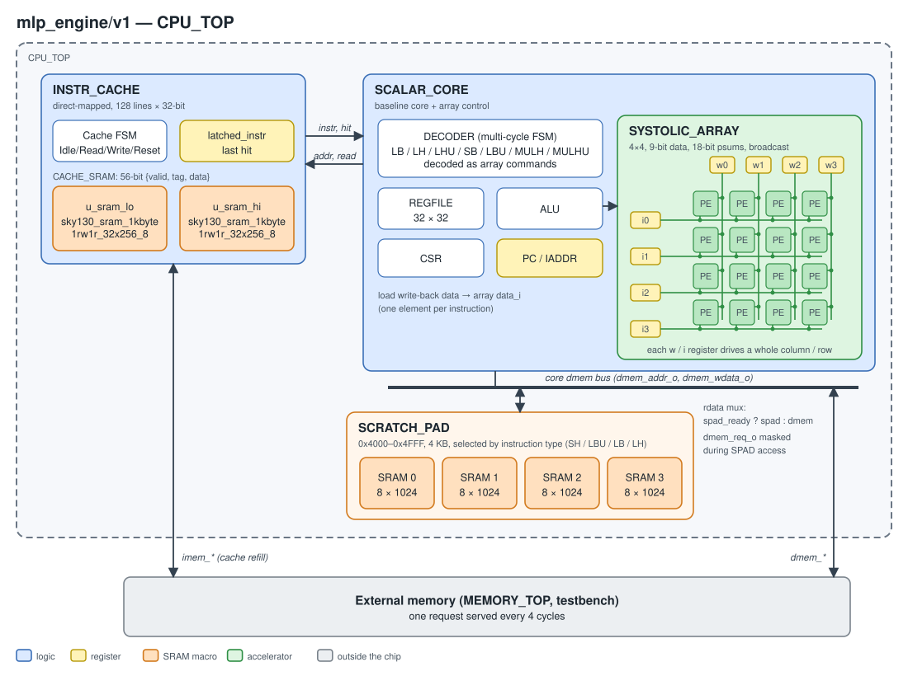

# mlp_engine/v1

The baseline core plus a 4×4 broadcast MAC array and a 4 KB scratchpad. Both
are controlled by repurposed standard RISC-V instructions.

<p align="center"></p>

## Blocks

| Block | Description |
|---|---|
| `CPU_TOP` (`cpu_top.sv`) | Instruction cache, core, and scratchpad. The scratchpad shares the core's dmem address/write-data bus; `rdata = spad_ready ? spad : dmem`. |
| `INSTR_CACHE` | Same as `scalar_core`. |
| `SCALAR_CORE` (`core/scalar_core.sv`) | Baseline multi-cycle core plus array control. The array's input is the core's load write-back data (one element per instruction). |
| `DECODER` (`core/decoder.sv`) | Decodes `LB`/`LH`/`LHU`/`SB`/`LBU`/`MULH`/`MULHU` as array/scratchpad commands. |
| `SYSTOLIC_ARRAY` (`core/systolic_array.sv`) | 4×4 broadcast MAC array. Weight register `registers[j]` drives every PE in column j, and input register `registers[4+i]` drives every PE in row i. All PEs compute in the same cycle. |
| `SCRATCH_PAD` (`scratch_pad/scratch_pad.sv`) | 0x4000–0x4FFF, 4 KB, built from 4 × `sky130_sram_1kbyte_1rw1r_8x1024_8`. Selected by instruction type (`SH`/`LBU`/`LB`/`LH`). |

## Instruction mapping (standard opcodes repurposed)

| Instruction | v1 meaning |
|---|---|
| `LB` | scratchpad → array PE buffer (bias) |
| `LBU` | array PE buffer → scratchpad |
| `LH` | scratchpad → array data buffer |
| `LHU` | external memory → array data buffer |
| `SB` | array PE buffer → external memory |
| `SH` | external memory → scratchpad |
| `MULH` | MAC in every PE |
| `MULHU` | ReLU (negative → 0) in every PE |

## Data widths in the array

| Item | Width | Notes |
|---|---|---|
| Activation | 9-bit unsigned | Bits [8:1] of the loaded 32-bit value, with LSB forced to 1 (`{rf_write_data[8:1], 1'b1}`) |
| Weight | 9-bit signed | Same extraction |
| Bias | 9-bit | Loaded from the scratchpad with `LB` and zero-extended into the 18-bit partial sum |
| Product | 18-bit | 10-bit signed weight × 10-bit zero-extended activation = 20 bits, truncated to 18 bits |
| Partial sum | 18-bit | Accumulated by `MULH` (wraps on overflow, no detection); `MULHU` sets negative values to 0 |
| Output | 9-bit | MSB of the partial sum = 1 → `0x1FF` (saturate); otherwise `psum[16:8] + psum[7]` (round) |
| Scratchpad entry | 8-bit | Stores bits [8:1] of the written value; on read the LSB is forced back to 1 |

## RTL fix for PnR

`core/systolic_array.sv` had three index counters clocked by the falling edge
of data signals instead of `clk`. They now run on `clk` with enables.

```systemverilog
// before
always_ff @(negedge bias_ready_i or negedge rstn)   // pidx: psum write index
always_ff @(negedge data_ready_i or negedge rstn)   // sidx: input/weight write index
always_ff @(negedge data_req     or negedge rstn)   // ridx: psum read index

// after
always_ff @(posedge clk or negedge rstn) ... else if (bias_ready_i) pidx <= pidx + 1;
always_ff @(posedge clk or negedge rstn) ... else if (data_ready_i) sidx <= sidx + 1;
always_ff @(posedge clk or negedge rstn) ... data_req_q <= data_req;
                                             if (data_req_q & ~data_req) ridx <= ridx + 1;
```

The three signals are combinational data signals generated in the core:

```systemverilog
// core/scalar_core.sv:250-252
assign systolic_bias_write_en = dec_write_en & lb;            // → bias_ready_i
assign systolic_data_write_en = dec_write_en & (lh | lhu);    // → data_ready_i
assign systolic_read_en       = dmem_write_o & (sb | lbu);    // → data_req
```

Using them as flip-flop clocks causes three problems:

1. **STA cannot check those flip-flops.** The only clock in the SDC is `clk_i`,
   so these flip-flops become unclocked registers, and their paths are left
   out of setup/hold analysis. Re-synthesizing the pre-fix RTL with the same
   config and running pre-PnR `check_setup` confirms this:

   | RTL | Unclocked register pins | Unconstrained endpoints |
   |---|---:|---:|
   | Before | **23** (`SCORE.ACCELERATOR.*/CLK`) | 25 (their D pins + `vccd1`, `vssd1`) |
   | After | **0** | 2 (`vccd1`, `vssd1`) |

   23 is exactly the counter width: `pidx` 4 bits × 4 rows + `sidx` 3 bits +
   `ridx` 4 bits.
2. **CTS does not treat them as clocks.** They are not buffered or balanced as
   clock nets. Their timing relative to each other and to the `clk` domain is
   not guaranteed.
3. **They react to glitches.** A glitch on a combinational output that looks
   like a falling edge advances a counter, which misaligns the write/read
   index. Zero-delay gate-level simulation cannot catch this.

After the fix, accuracy and `minstret` match the pre-fix RTL. Mcycle is 51.4%
of the pre-fix value and close to the original SAED32 results.
